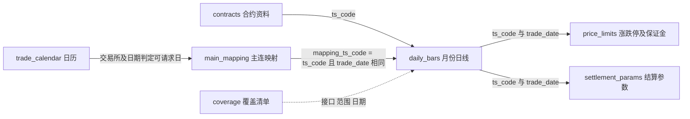
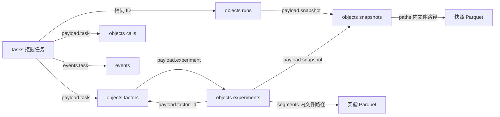

# 沪铜量化 MVP 数据库设计说明

本文描述**当前已经实现的数据库**，用于在 DBeaver 中逐表、逐字段对照。数据库结构由只读查询实际主库得到；代码负责解释写入与使用规则。本文不修改数据库。

- 主库：`/Users/lucienzeng/Documents/ChatGPT/期货因子挖掘/AlphaGPT_Tushare/runtime/research.sqlite`
- 结构核对日期：2026-10-18（已纳入结算参数缺口容错改造）。行数是编写时快照，后续同步和挖掘会变化。
- [连接 DBeaver 的步骤](SQLite与DBeaver.md) · [可执行关系查询](数据库关系查询.sql) · [机器可读结构快照](数据库结构快照.json)

## 1. 先看这几个关系

**月份合约是行情存储的基本单位，主连单独保存每日映射。**

| 想看什么 | 在 DBeaver 中打开 | 识别一条记录的关键字段 |
| --- | --- | --- |
| 某份真实合约的价格和成交量 | 沪铜_月份合约行情 / daily_bars | ts_code + trade_date |
| 当天主力是哪份合约 | 沪铜_主力映射 / main_mapping | 主连 ts_code + trade_date |
| 主连对应的原始价格 | 沪铜_主连未复权行情 | mapping_ts_code + trade_date 关联月份行情 |
| 每手吨数、上市和到期日 | 期货_合约信息 / contracts | ts_code |
| 涨跌停、保证金、结算参数 | price_limits / settlement_params | 实际月份 ts_code + trade_date |
| 下载了哪些日期，有哪些缺口 | 期货_同步清单 / 期货_数据缺口 | 接口 + 合约或交易所 + 日期 |
| 因子中文解释及回测指标 | objects | kind + id；展开 payload JSON |
| 下载、挖掘任务进度和日志 | tasks / events | tasks.id = events.task |

### 1.1 关联图

以下全部是**逻辑关联**。当前数据库未声明 `FOREIGN KEY`，DBeaver 不会自动绘出这些连线；需要按本文理解或自行配置虚拟关联。应用通过写入校验、关联查询和质量检查约束这些关系。



合约与月份日线是“一份合约、多天行情”。一条月份日线按合约和交易日最多关联一条涨跌停记录、一条结算参数记录，但可能因尚未下载而缺少。主连映射不等于复权行情，也不是独立的可交易合约。

### 1.2 一条真实数据贯穿四张表

本地主库中，`2024-12-31` 的 `CU.SHF` 映射到 `CU2502.SHF`：

| 来源 | 字段 | 实际值 | 含义 |
| --- | --- | --- | --- |
| main_mapping | ts_code | CU.SHF | 主连序列名称 |
| main_mapping | mapping_ts_code | CU2502.SHF | 真实月份合约 |
| daily_bars | open / close / settle | 73960 / 73770 / 73800 | 元/吨，原始价格 |
| daily_bars | vol | 60003 | 手 |
| daily_bars | amount | 2214352.965 | 万元 |
| contracts | per_unit | 5 | 每手 5 吨 |
| price_limits | m_ratio | 9 | 最低交易保证金率 9% |

关联行情应使用 `b.ts_code = m.mapping_ts_code AND b.trade_date = m.trade_date`。直接把 `m.ts_code` 与月份行情的 `ts_code` 相等连接，会把主连代码和真实合约混在一起。

## 2. 存储边界与统一约定

| 位置 | 内容 | 用途 |
| --- | --- | --- |
| runtime/research.sqlite | 六类原始数据、覆盖清单、任务日志、研究对象元数据 | 当前可增量更新的主库，DBeaver 可以查看 |
| runtime/snapshots/ | 冻结的行情、映射、合约、涨跌停、结算参数 Parquet | 固定某次研究的数据版本 |
| runtime/experiments/ | 因子值、逐日账本、成交、标签、manifest | 回测详细结果；数据库存路径与摘要 |
| runtime/logs/ | 按任务保存的 JSONL | 任务事件文件副本 |
| runtime/cache/ | 旧版原始 Parquet | 迁移来源备留；运行时不再更新或回读 |
| runtime/backups/ | 迁移前备份 | 恢复与核对 |

SQLite 并非承载所有结果的大文件：原始行情已经是普通 SQL 列，但因子、实验元数据仍采用 JSON，冻结的大表仍保留 Parquet。DBeaver 可以查询结果指标和文件路径，详细逐日曲线由研究界面读取文件展示。

- 日期列为 `TEXT`，统一 `YYYY-MM-DD`，可直接比较日期范围；API 原始日期在接入层规范化。
- 时间戳为 UTC ISO 文本，常见 `+00:00` 后缀；与交易日、供应商发布时间是三种不同概念。
- `REAL` 是浮点数存储。成交量和持仓量虽然通常是整手，仍保留 SDK 数值类型。
- `NULL` 表示缺失或未提供，不代表数值 0；缺行与某个字段为空也不同。
- 下文字典“非空”来自实际 `PRAGMA table_info`。旧元数据表的部分文本/联合主键未显式声明 `NOT NULL`，不要误认为数据库已强制非空；应用写入正常会提供业务键。
- 六张原始表统一有 `_scope`、`_updated_at`、`_source_task`。这些字段不送进因子特征计算。
- 供应商新增列可动态加入原始表；本文和结构快照只反映核对时结构。

## 3. 完整表与字段字典

“PK1、PK2”表示联合主键的第几个字段；单字段主键记 PK1。除明确标记非空的列外，数据库允许空值。

### 3.1 `contracts` — 合约资料

当前 392 行；主键：`ts_code`。数据来自 `fut_basic`。

| 字段 | SQLite 类型 | 键 / 非空 | 含义与使用规则 |
| --- | --- | --- | --- |
| `ts_code` | TEXT | PK1/非空 | Tushare 合约代码，例 CU2502.SHF；主键。元数据中也可能存在连续合约代码 |
| `symbol` | TEXT | — | 交易所合约符号，例 CU2502 |
| `exchange` | TEXT | — | 交易所代码，当前沪铜为 SHFE |
| `name` | TEXT | — | 合约中文名称 |
| `fut_code` | TEXT | — | 品种代码；沪铜为 CU |
| `trade_unit` | TEXT | — | 交易计量单位，如吨 |
| `quote_unit` | TEXT | — | 报价单位 |
| `quote_unit_desc` | TEXT | — | 报价单位说明 |
| `d_mode_desc` | TEXT | — | 交割方式说明 |
| `list_date` | TEXT | — | 上市日期 |
| `delist_date` | TEXT | — | 最后交易日；不是最后交割日 |
| `d_month` | TEXT | — | 交割月份；按接口原值保留 |
| `last_ddate` | TEXT | — | 最后交割日 |
| `trade_time_desc` | TEXT | — | 交易时间说明；接口未返回时可为空 |
| `multiplier` | REAL | — | 合约乘数；商品每手数量优先使用 per_unit，不把本列空值解释为 0 |
| `per_unit` | REAL | — | 每手数量；当前沪铜为 5 吨/手 |
| `_scope` | TEXT | 非空 | 本地请求范围；contracts 为 CU、trade_calendar 为 SHFE，其他表为请求 ts_code |
| `_updated_at` | TEXT | 非空 | 最近本地写入时间，UTC ISO 文本；迁移时为导入时间，不是历史发布时间 |
| `_source_task` | TEXT | — | 来源下载任务 ID；迁移行记迁移运行 ID，不能保证在 tasks 中找到 |

### 3.2 `trade_calendar` — 交易日历

当前 1,271 行；主键：`exchange, cal_date`。数据来自 `fut_trade_cal`。

| 字段 | SQLite 类型 | 键 / 非空 | 含义与使用规则 |
| --- | --- | --- | --- |
| `exchange` | TEXT | PK1/非空 | 交易所代码；与 cal_date 组成主键 |
| `cal_date` | TEXT | PK2/非空 | 自然日日期；与 exchange 组成主键 |
| `is_open` | INTEGER | — | 是否交易日：1 是、0 否 |
| `pretrade_date` | TEXT | — | 前一交易日 |
| `_scope` | TEXT | 非空 | 本地请求范围；contracts 为 CU、trade_calendar 为 SHFE，其他表为请求 ts_code |
| `_updated_at` | TEXT | 非空 | 最近本地写入时间，UTC ISO 文本；迁移时为导入时间，不是历史发布时间 |
| `_source_task` | TEXT | — | 来源下载任务 ID；迁移行记迁移运行 ID，不能保证在 tasks 中找到 |

### 3.3 `daily_bars` — 真实月份合约日线

当前 4,839 行；主键：`ts_code, trade_date`。数据来自 `fut_daily`。

| 字段 | SQLite 类型 | 键 / 非空 | 含义与使用规则 |
| --- | --- | --- | --- |
| `ts_code` | TEXT | PK1/非空 | 实际月份合约代码；与 trade_date 组成主键 |
| `trade_date` | TEXT | PK2/非空 | 供应商交易日；夜盘归属沿用接口，不按自然日自行平移 |
| `pre_close` | REAL | — | 昨收盘价，元/吨 |
| `pre_settle` | REAL | — | 昨结算价，元/吨 |
| `open` | REAL | — | 开盘价，元/吨 |
| `high` | REAL | — | 最高价，元/吨 |
| `low` | REAL | — | 最低价，元/吨 |
| `close` | REAL | — | 收盘价，元/吨 |
| `settle` | REAL | — | 当日结算价，元/吨；回测逐日盯市使用 |
| `change1` | REAL | — | 涨跌 1 = close − pre_settle，元/吨 |
| `change2` | REAL | — | 涨跌 2 = settle − pre_settle，元/吨 |
| `vol` | REAL | — | 成交量，手；保留供应商原始统计口径 |
| `amount` | REAL | — | 成交金额，万元；不要与其他接口的金额单位混用 |
| `oi` | REAL | — | 持仓量，手 |
| `oi_chg` | REAL | — | 持仓量变化，手 |
| `delv_settle` | REAL | — | 交割结算价，元/吨；可选字段，可能为空 |
| `_scope` | TEXT | 非空 | 本地请求范围；contracts 为 CU、trade_calendar 为 SHFE，其他表为请求 ts_code |
| `_updated_at` | TEXT | 非空 | 最近本地写入时间，UTC ISO 文本；迁移时为导入时间，不是历史发布时间 |
| `_source_task` | TEXT | — | 来源下载任务 ID；迁移行记迁移运行 ID，不能保证在 tasks 中找到 |

### 3.4 `main_mapping` — 主连到月份合约的映射

当前 840 行；主键：`ts_code, trade_date`。数据来自 `fut_mapping`。

| 字段 | SQLite 类型 | 键 / 非空 | 含义与使用规则 |
| --- | --- | --- | --- |
| `ts_code` | TEXT | PK1/非空 | 主连代码，当前 CU.SHF；不是实际月份合约 |
| `trade_date` | TEXT | PK2/非空 | 映射对应交易日；与 ts_code 组成主键 |
| `mapping_ts_code` | TEXT | — | 当天映射到的实际月份合约，例 CU2502.SHF；关联其他行情表用本字段 |
| `_scope` | TEXT | 非空 | 本地请求范围；contracts 为 CU、trade_calendar 为 SHFE，其他表为请求 ts_code |
| `_updated_at` | TEXT | 非空 | 最近本地写入时间，UTC ISO 文本；迁移时为导入时间，不是历史发布时间 |
| `_source_task` | TEXT | — | 来源下载任务 ID；迁移行记迁移运行 ID，不能保证在 tasks 中找到 |

### 3.5 `price_limits` — 涨跌停与最低保证金

当前 4,839 行；主键：`ts_code, trade_date`。数据来自 `ft_limit`。

| 字段 | SQLite 类型 | 键 / 非空 | 含义与使用规则 |
| --- | --- | --- | --- |
| `ts_code` | TEXT | PK1/非空 | 实际月份合约代码；与 trade_date 组成主键 |
| `trade_date` | TEXT | PK2/非空 | 参数适用交易日 |
| `name` | TEXT | — | 合约名称 |
| `up_limit` | REAL | — | 涨停价格，元/吨 |
| `down_limit` | REAL | — | 跌停价格，元/吨 |
| `m_ratio` | REAL | — | 最低交易保证金率，百分数；9 表示 9%，引擎除以 100 |
| `cont` | TEXT | — | 合约品种代码，例 CU；不是主连代码 |
| `exchange` | TEXT | — | 交易所代码 |
| `_scope` | TEXT | 非空 | 本地请求范围；contracts 为 CU、trade_calendar 为 SHFE，其他表为请求 ts_code |
| `_updated_at` | TEXT | 非空 | 最近本地写入时间，UTC ISO 文本；迁移时为导入时间，不是历史发布时间 |
| `_source_task` | TEXT | — | 来源下载任务 ID；迁移行记迁移运行 ID，不能保证在 tasks 中找到 |

### 3.6 `settlement_params` — 结算及手续费参数

当前 4,794 行；主键：`ts_code, trade_date`。数据来自 `fut_settle`。

| 字段 | SQLite 类型 | 键 / 非空 | 含义与使用规则 |
| --- | --- | --- | --- |
| `ts_code` | TEXT | PK1/非空 | 实际月份合约代码；与 trade_date 组成主键 |
| `trade_date` | TEXT | PK2/非空 | 参数适用交易日 |
| `exchange` | TEXT | — | 交易所代码 |
| `settle` | REAL | — | 该参数接口的结算价；与 daily_bars.settle 分别保留 |
| `trading_fee_rate` | REAL | — | 交易手续费率；保留原值，需核对历史适用单位和口径 |
| `trading_fee` | REAL | — | 交易手续费；保留原值，不统一猜测为元/手 |
| `delivery_fee` | REAL | — | 交割手续费；保留原值 |
| `b_hedging_margin_rate` | REAL | — | 买套保交易保证金率；保留原值 |
| `s_hedging_margin_rate` | REAL | — | 卖套保交易保证金率；保留原值 |
| `long_margin_rate` | REAL | — | 买投机交易保证金率；保留原值 |
| `short_margin_rate` | REAL | — | 卖投机交易保证金率；保留原值 |
| `offset_today_fee` | REAL | — | 平今仓手续费参数；接口称平今仓手续率，不将其擅自当固定费用 |
| `_scope` | TEXT | 非空 | 本地请求范围；contracts 为 CU、trade_calendar 为 SHFE，其他表为请求 ts_code |
| `_updated_at` | TEXT | 非空 | 最近本地写入时间，UTC ISO 文本；迁移时为导入时间，不是历史发布时间 |
| `_source_task` | TEXT | — | 来源下载任务 ID；迁移行记迁移运行 ID，不能保证在 tasks 中找到 |

### 3.7 `coverage` — 逐日覆盖清单

当前 16,583 行；主键：`dataset, symbol, day`。

| 字段 | SQLite 类型 | 键 / 非空 | 含义与使用规则 |
| --- | --- | --- | --- |
| `dataset` | TEXT | PK1 | 接口名，例 fut_daily；联合主键之一 |
| `symbol` | TEXT | PK2 | 覆盖范围：月份合约、CU.SHF 或 SHFE；联合主键之一 |
| `day` | TEXT | PK3 | 已覆盖日期，YYYY-MM-DD；联合主键之一 |
| `version` | TEXT | — | 原始口径标记，当前 raw-v1；不属于主键，不是完整修订历史 |

### 3.8 `market_catalog` — 原始 DataFrame 结构目录

当前 78 行；主键：`dataset, symbol`。

| 字段 | SQLite 类型 | 键 / 非空 | 含义与使用规则 |
| --- | --- | --- | --- |
| `dataset` | TEXT | PK1/非空 | 接口名；与 symbol 组成主键 |
| `symbol` | TEXT | PK2/非空 | 数据范围；对应原始表 _scope |
| `schema_json` | TEXT | 非空 | JSON：columns 为原始字段顺序，dtypes 为 pandas 类型映射；不含三个内部追踪列 |
| `row_count` | INTEGER | 非空 | 该接口、范围的缓存行数；外部直接改表可能导致统计失真 |
| `updated_at` | TEXT | 非空 | 本地最近写入时间，UTC |
| `source_task` | TEXT | — | 最近来源任务 ID，或迁移运行 ID |

### 3.9 `market_migrations` — 迁移完成记录

当前 1 行；主键：`name`。

| 字段 | SQLite 类型 | 键 / 非空 | 含义与使用规则 |
| --- | --- | --- | --- |
| `name` | TEXT | PK1 | 迁移名称，主键；当前 parquet_cache_to_sqlite_v1 |
| `completed_at` | TEXT | 非空 | 迁移完成时间，UTC |
| `report_json` | TEXT | 非空 | JSON 迁移报告：运行 ID、备份、文件、校验及请求数等 |

### 3.10 `tasks` — 任务状态

当前 18 行；主键：`id`。

| 字段 | SQLite 类型 | 键 / 非空 | 含义与使用规则 |
| --- | --- | --- | --- |
| `id` | TEXT | PK1 | 任务 ID，主键；例 sync_日期_时间_随机后缀 |
| `kind` | TEXT | — | 任务类型：sync、mine、connection、retest、final_test |
| `status` | TEXT | — | queued / running / succeeded / failed / stopped / interrupted |
| `created` | TEXT | — | 创建时间，UTC |
| `updated` | TEXT | — | 最后更新任务状态的时间，UTC |
| `fingerprint` | TEXT | — | 任务类型和参数生成的指纹；用于识别相同的活动任务 |
| `params` | TEXT | — | 提交时冻结的参数，JSON；包含下载区间或模型、快照、回测配置等 |
| `payload` | TEXT | — | 运行状态 JSON；阶段、进度、结果或错误等，随执行更新 |
| `cancel` | INTEGER | — | 取消请求标记，默认 0；1 表示请求停止，不等于已经停止 |

### 3.11 `events` — 任务事件日志

当前 1,345 行；主键：`seq`。

| 字段 | SQLite 类型 | 键 / 非空 | 含义与使用规则 |
| --- | --- | --- | --- |
| `seq` | INTEGER | PK1 | 自增整数主键；查看同一任务日志可按本列排序 |
| `task` | TEXT | — | 所属任务 ID，逻辑关联 tasks.id |
| `time` | TEXT | — | 事件记录时间，UTC |
| `event` | TEXT | — | 事件名称，如 api_response、model_response、backtest_segment |
| `payload` | TEXT | — | 事件详情，JSON；具体键随事件类型变化 |

### 3.12 `objects` — 研究对象与元数据

当前 37 行；主键：`kind, id`。

| 字段 | SQLite 类型 | 键 / 非空 | 含义与使用规则 |
| --- | --- | --- | --- |
| `kind` | TEXT | PK1 | 对象类别；与 id 组成主键，详见对象字典 |
| `id` | TEXT | PK2 | 该类别下的对象 ID；不同 kind 可有相同 id |
| `created` | TEXT | — | 首次插入时间，UTC；更新 payload 时本列不变 |
| `payload` | TEXT | — | 对象内容，JSON 文本；不同 kind 的结构不同 |

### 3.13 关键字段的使用限制

1. **成交量口径**：本地 Tushare 文档说明 2020-01-01 前为双边统计、之后为单边统计。原始库不改值；量持仓变化特征在统计变化处按实现分段预热，不能任意将全部历史字段除二。
2. **费用参数**：`settlement_params` 按接口原值存储，文档没有完整说明所有参数的历史单位。当前历史费用分支只接受能明确区分的单一正值费率或固定费用；有歧义时失败。引擎费率分支按小数费率计算，这不代表已经验证所有历史原值的单位。默认固定手续费是研究假设，选择历史模式前仍需核对。
3. **保证金**：当前引擎使用 `price_limits.m_ratio / 100`，缺失时按配置的后备比例处理；并非自动使用 `settlement_params` 内所有保证金列。最低交易保证金不等于期货公司的实际要求。
4. **两个 settle**：逐日盯市采用 `daily_bars.settle`；结算参数中的同名列另行保留。SQL 查询时用明确别名，避免合并后无法区分来源。
5. **当前值与历史版本**：原始表按主键更新，只保留当前一份值；`coverage.version` 不是逐次修订历史。历史实验的可复现性来自冻结快照和实验文件。
6. **索引**：六张原始表均有主键索引和 `_scope` 索引，有日期列的表另有日期索引。当前未额外建立 `events.task` 索引；日志量很大时可评估优化，本文不修改结构。

### 3.14 `data_gaps` — 可补充的下载缺口记录

主键为 `(dataset, symbol, day)`，每个接口、合约、日期只有一条当前记录；反复尝试累加次数，详细尝试历史保存在 events 和任务 JSONL。

| 字段 | 类型 | 含义 |
| --- | --- | --- |
| dataset | TEXT 非空 PK1 | 数据接口，当前记录 fut_settle |
| symbol | TEXT 非空 PK2 | 实际月份合约代码 |
| day | TEXT 非空 PK3 | 缺失交易日，YYYY-MM-DD |
| reason | TEXT 非空 | 发现缺口时的原因；没有填值或写覆盖标记 |
| status | TEXT 非空 | open 待补充；resolved 已补齐 |
| first_seen | TEXT 非空 | 首次发现 UTC 时间，后续重试不改 |
| last_seen | TEXT 非空 | 最近一次确认缺失的 UTC 时间 |
| attempts | INTEGER 非空 | 确认缺失的请求次数，初始 1；不是网络重试次数 |
| source_task | TEXT | 最近确认缺失的任务 ID，逻辑关联 tasks.id |
| resolved_at | TEXT | 数据经 MarketData.write 补齐时自动记录 UTC 时间；与数据写入同事务 |

`data_gaps` 与 `coverage` 的含义相反：缺口不是已覆盖。普通同步会继续重试缺失日期；补齐后关闭缺口，保留历史行。若以后再次确认缺失，可重新打开。直接用外部 SQL 插入原始表不会触发应用的状态更新，其他来源补数应经统一写入入口，并保存来源信息。

结算参数整段为空或部分日期缺失时，写入本表并输出 `settlement_gap_warning` 到任务事件、JSONL 与服务控制台，继续其他合约；权限、网络、格式错误仍按原有规则失败。行情、主力映射、涨跌停不适用本容错。快照 `quality.settlement_missing_rows` 记录该快照月份行情缺少结算参数的行数，`settlement_policy` 记录使用限制。历史手续费回测缺少实际成交日参数时仍失败，固定成本模式可运行。

## 4. objects：因子、快照和实验如何关联

当前没有独立的 `factors`、`experiments` SQL 表；它们是 `objects` 中不同 `kind` 的记录。先按 `kind` 筛选，再使用 SQLite `json_extract(payload, '$.字段')` 读取内容。



箭头表示定位关系，不代表数据库外键。`runs.id = tasks.id` 适用于挖掘运行；实验的 `payload.task` 也可能指向重测或最终测试任务，不一定等于因子的原始挖掘任务。

| kind | id 规则 / 用途 | payload 关键字段与关系 |
| --- | --- | --- |
| snapshots | cu_内容哈希 | start、end 为研究区间，warmup_start 为预热起点；paths 指向五类快照文件；quality、rows、contracts 为质量及规模；download_task 指向下载任务 |
| runs | 挖掘任务 ID | config 为冻结配置；snapshot 指向 snapshots.id；created、version 记录运行环境 |
| calls | call_… | task 关联 tasks；profile、prompt、status 为模型调用记录；成功时可有 raw_response、content、usage、total_tokens、actual_model，失败时可有 error；字段随调用结果变化 |
| rounds | 任务 ID_轮次 | round 为轮次；candidates 为本轮候选；feedback_at_request 为请求模型时使用的反馈 |
| factors | 任务 ID_轮次_候选序号等 | task、round、source；name_zh 中文名，expression 表达式，logic_zh 中文逻辑；expected_direction、market_regime、failure_risks；status、reason；成功后 experiment 指向实验，valid_metrics 为验证指标摘要 |
| experiments | eval_… / test_… | factor_id 指向 factors.id；factor 是评估时的因子内容副本；snapshot 指向 snapshots.id；config、version 固定配置与版本；task 指向执行任务；segments 保存分段结果；parent_experiment 指向原实验；kind 为 development / test |
| test_access | 最终测试任务 ID | parent 指原实验，factor 为因子 ID；config、viewed_at、note 记录测试集访问 |
| cache | 接口名，当前 fut_basic | updated、rows；元数据缓存新鲜度标记，不保存原始行情 |
| acceptance | 验收运行标识 | 验收检查、快照、任务、指标与导出信息；属于验证记录 |
| repair_coverage | 任务 ID/接口/范围 | days 为任务内已完成修复日期；按需产生，可能当前无记录 |
| tail_checks | 接口/范围 | updated 为最近尾部复查时间；按需产生，可能当前无记录 |

对象 JSON 是按工作流逐步补全的，不是每条都有全部列出的键。`parent_factor_id` 等候选附带字段如存在，也是逻辑元信息，不是已声明的数据库外键。实验中的 `factor` 副本可能早于因子后续补入 `experiment`、`valid_metrics`，应通过 `factor_id` 查找当前因子记录。

### 4.1 回测结果路径与指标

`experiments.payload.segments` 在开发实验中包含 `train`、`valid`，最终测试包含 `test`。每段结构：

```json
{
  "start": "该段起始日期",
  "end": "该段结束日期",
  "metrics": {"total_return": 0.0, "sharpe": 0.0},
  "daily": "experiments/<实验ID>/<分段>_daily.parquet",
  "trades": "experiments/<实验ID>/<分段>_trades.parquet",
  "labels": "experiments/<实验ID>/<分段>_labels.parquet"
}
```

以上为结构示意，0 不是实际回测收益。路径相对于 `runtime/`。同一实验目录还有 `factor.parquet` 和 `manifest.json`。

| 指标字段 | 含义 / 展示时注意 |
| --- | --- |
| total_return / gross_total_return | 净总收益 / 毛总收益；比例值，0.1 显示为 10% |
| annual_return / annual_volatility | 年化收益 / 年化波动；比例值 |
| max_drawdown | 最大回撤，非正比例值；-0.1 表示回撤 10% |
| sharpe / calmar | 风险调整指标；无量纲 |
| ic / rank_ic / ic_samples | 因子与标签的相关系数、秩相关及有效样本数 |
| fees / slippage_cost | 手续费、滑点成本汇总，元 |
| trade_count / turnover | 成交记录数 / 各次成交名义金额除以成交日前权益的累计值；换月平旧开新分别计入 |
| max_margin_ratio | 最大保证金占用比例 |
| win_rate / win_rate_definition | 毛盈亏非零的交易日中，净盈亏为正的天数占比；不是完整逐笔交易胜率 |
| days | 实际参与计算的交易日数量 |

指标精确定义以 `src/alphagpt/backtest/futures.py` 的计算实现和实验 `config` 为准。比较因子时同时对照数据快照、训练验证区间、信号滞后、成本和资金参数。

## 5. 十一个中文视图的数据来源

视图只是查询入口，不额外保存一份行情。

| 视图 | 来源 / 关联 | 适合查看 |
| --- | --- | --- |
| 期货_合约信息 | contracts，中文别名 | 合约身份、每手数量、上市及到期 |
| 期货_交易日历 | trade_calendar | 开休市与前交易日 |
| 期货_同步清单 | coverage | 每个接口、范围已覆盖的日期 |
| 期货_数据覆盖 | 六张原始表按 _scope 分组后 UNION ALL | 行数、最早最晚日期、最后入库时间 |
| 期货_涨跌停与保证金 | price_limits | 涨跌停价与最低保证金百分数 |
| 期货_结算参数 | settlement_params 的常用列 | 原始费用和保证金参数，完整列看原表 |
| 沪铜_月份合约行情 | daily_bars LEFT JOIN contracts，按 ts_code | 月份价格、量、持仓、到期日 |
| 沪铜_主力映射 | main_mapping | 主连与真实合约对应关系 |
| 沪铜_主连未复权行情 | main_mapping LEFT JOIN daily_bars，按 mapping_ts_code + trade_date | 主力拼接价格及是否匹配；不是复权收益序列 |
| 期货_下载缺口记录 | data_gaps 的中文字段别名，保留 open/resolved 两种状态 | 已确认的缺口、任务、次数及补齐时间 |
| 期货_数据缺口 | 映射缺行情、行情缺涨跌停、行情缺结算参数，UNION ALL | 已入库表之间的关联缺口 |

当前视图名含“沪铜”，但定义依赖当前只下载沪铜的业务约定，没有额外的 CU 过滤条件。以后支持其他品种时应调整视图命名或加过滤，避免混看。

“数据覆盖”的最早与最晚日期不能证明中间没有缺口。“数据缺口”不会全面扫描所有日历日期、所有未下载合约，也不会检测每个非键字段是否为空。同一合约同一天缺两类参数会出现两行。

## 6. 下载到回测的数据生命周期

1. 界面提交生成 `tasks`，冻结 `params`；执行过程写 `events`，并追加 `runtime/logs/<任务ID>.jsonl`。
2. 接入层查询交易日历、合约元数据和主连映射，确定所选区间及预热期需要的真实月份合约；元数据多于行情合约数量是正常的。
3. 按接口、范围、日期对照 `coverage` 和真实 SQL 行，补新增及缺口。普通历史同步跳过已完整覆盖日期；显式修复、尾部复查和元数据到期更新有各自规则。
4. 每个分段用事务同时更新原始表、`market_catalog`、`coverage` 及修复检查点；主键 UPSERT 防重复。空响应不标记成功；结算参数缺失另记 data_gaps 并继续。失败任务已完成分段可以留在主库，任务失败不代表之前的数据整批回滚。
5. 成功同步从主库生成冻结快照，登记 `objects(kind='snapshots')`。之后修复主库不会改写旧实验依赖的快照。
6. 挖掘运行登记 runs、calls、rounds、factors；因子只读取指定快照。信号用连续衔接价格，成交和盯市按真实月份合约，换月分别平旧开新。
7. 回测登记 experiments，保存分段指标及文件路径；最终测试单独留 test_access 记录。

原始数据默认按账号/接口预算限速，默认 30 次/分、并发 1；限频由接入层实现，不是 SQLite 表的约束。详情见 [接口与研究口径](接口约定.md)。

### 6.1 一致性、日志与来源追踪

- SQLite 使用 WAL，应用单执行器写入，连接超时 30 秒；可同时通过 DBeaver 读取。
- `events` 和 JSONL 先后写入，两者不是同一个原子事务。异常中断时不应假设文件副本与 SQL 永远完全一致。
- `_source_task` 为普通下载任务时可以关联 `tasks.id`。迁移导入行为迁移运行 ID，应查 `market_migrations.report_json` 及备份、验收日志，不能当成任务外键。
- `market_catalog` 记录列顺序与 pandas 类型，应用读 SQL 后恢复类型，保持特征和快照哈希一致。
- 完成迁移以 `market_migrations.name` 记录，防止旧 Parquet 再导入覆盖主库新值；迁移前备份位于 `runtime/backups/<迁移ID>/`。
- 建议通过应用同步和修复数据；手工改业务表不会自动同步覆盖清单、目录统计和冻结快照。

## 7. DBeaver 对照查看顺序与 SQL

建议先打开“沪铜_主力映射”，选定日期与实际合约，再看月份行情、合约资料及两张参数表；然后查看“期货_数据覆盖”和“期货_数据缺口”。最后通过因子和实验查询查看研究结果。

以下所有查询均在 [数据库关系查询.sql](数据库关系查询.sql) 中，可以逐条执行。示例中的日期可替换；包含 JSON 的查询需要支持 SQLite JSON 函数的驱动。

```sql
SELECT m.ts_code AS 主连代码, m.trade_date AS 交易日,
       m.mapping_ts_code AS 实际月份合约, c.name AS 合约名称,
       c.per_unit AS 每手吨数, c.delist_date AS 最后交易日,
       b.open AS 开盘价, b.close AS 收盘价, b.settle AS 行情结算价,
       b.vol AS 成交量_手, b.oi AS 持仓量_手,
       p.up_limit AS 涨停价, p.down_limit AS 跌停价,
       p.m_ratio AS 最低保证金率_百分数,
       s.settle AS 参数结算价, s.trading_fee_rate AS 原始手续费率,
       s.trading_fee AS 原始手续费参数
FROM main_mapping m
LEFT JOIN contracts c ON c.ts_code=m.mapping_ts_code
LEFT JOIN daily_bars b ON b.ts_code=m.mapping_ts_code AND b.trade_date=m.trade_date
LEFT JOIN price_limits p ON p.ts_code=m.mapping_ts_code AND p.trade_date=m.trade_date
LEFT JOIN settlement_params s ON s.ts_code=m.mapping_ts_code AND s.trade_date=m.trade_date
WHERE m.ts_code='CU.SHF' AND m.trade_date='2024-12-31';
```

其余查询涵盖月份行情、覆盖统计、缺口分类、中文因子逻辑、实验分段指标、最新同步日志、行情来源任务、迁移备份和字段类型目录。对象关联时必须同时限制 `kind` 和 `id`，不能只按 `id` 连接。

## 8. 结构基线与实现位置

以下行数用于核对编写时主库，并不是永久应满足的目标数量。SQLite 内部表 `sqlite_sequence` 不列入业务表。

| 表 | 当前行数 |
| --- | ---: |
| `contracts` | 392 |
| `trade_calendar` | 1,271 |
| `daily_bars` | 8,939 |
| `main_mapping` | 840 |
| `price_limits` | 8,719 |
| `settlement_params` | 8,606 |
| `data_gaps` | 113 |
| `coverage` | 28,375 |
| `market_catalog` | 127 |
| `market_migrations` | 1 |
| `tasks` | 20 |
| `events` | 2,728 |
| `objects` | 37 |

实际主库共有 13 张业务/元数据表、11 个视图。结构快照保存每个对象的建表/建视图 SQL、字段类型、主键、非空声明、表索引及外键列表，不含原始行情和模型响应内容。

| 文件 | 负责内容 |
| --- | --- |
| src/alphagpt/data/sqlite.py | 六类原始表、中文视图、目录、原子写入、迁移 |
| src/alphagpt/research/storage.py | objects、coverage、tasks、events；JSON 与文件存取 |
| src/alphagpt/data/futures.py | 数据下载、日期规范化、覆盖补缺、冻结快照 |
| src/alphagpt/research/jobs.py | 任务生命周期、停止与恢复 |
| src/alphagpt/research/workflow.py | 研究对象关联、实验分段与路径 |
| src/alphagpt/factor/research.py | 连续信号价格与因子计算 |
| src/alphagpt/backtest/futures.py | 真实月合约账本、成本、保证金与指标 |

字段释义依据工作区的 [Tushare 期货数据文档](../../tushare_doc/期货数据.md)，使用规则依据上述本地实现。本文对资料未明确的费用参数保留原义，不补造单位。已有 SQLite 改造验收及迁移日志见 [SQLite 与 DBeaver 说明](SQLite与DBeaver.md#迁移与运行日志)。
